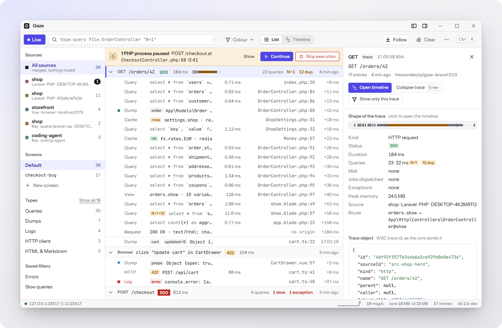

# thewonderjoy/gaze-laravel

See what your Laravel app is doing in the Gaze desktop app: your own `gaze()` calls, plus queries, logs, exceptions, mails, jobs and more, grouped by the request (or job, command, test) they came from.

Gaze is a fast debug window for PHP, Laravel and JavaScript (Windows first). This package builds on [`thewonderjoy/gaze-php`](https://packagist.org/packages/thewonderjoy/gaze-php).



Requires PHP 8.2+ and Laravel 12 or 13. Off in production unless you set `GAZE_ENABLED=true`.

```bash
composer require thewonderjoy/gaze-laravel
php artisan gaze:doctor    # checks that this app can reach Gaze
```

This is a normal dependency, as spatie/laravel-ray recommends. In production Gaze is off: it registers nothing, sends nothing and loads nothing but its service provider and a no-op, so a `gaze()`, `gaze_dd()`, `->gaze()` or `@gaze` you forgot to remove does nothing (`gaze_dd()` doesn't exit). If you add `--dev` instead, a forgotten call becomes a fatal error in production, so run `php artisan gaze:clean` before you deploy.

The service provider is discovered automatically. To change settings, publish the config: `php artisan vendor:publish --tag=gaze-config`.

## Use

```php
gaze('Hello', $user);                       // everything from gaze-php works
gaze()->model($order)->green();             // an Eloquent model with its relations
gaze()->mailable(new OrderShipped($order)); // a rendered mail
gaze()->showQueries();                      // show queries from here on
$total = gaze()->countQueries(fn () => $report->build());

collect($rows)->gaze('rows')->map(...);     // on collections, strings, query builders
User::where('active', true)->gaze()->get(); // the SQL with bindings, before it runs
$this->get('/orders')->gaze()->assertOk();  // on test responses
```

```blade
@gaze($order)
@gazeAll        {{-- every variable in this view --}}
@gazeMeasure    {{-- stopwatch --}}
```

## Methods

`gaze()` has every method of [gaze-php](https://packagist.org/packages/thewonderjoy/gaze-php) (values, colours, tables, `pause()`, `measure()`, `count()`, screens and so on). This package adds the Laravel ones, with the same names as spatie/laravel-ray.

**Laravel values**

| Method | What it shows |
|---|---|
| `model(...$models)` | Eloquent models with their attributes and loaded relations, one entry per model. Collections are flattened. |
| `models($collection)` | The same, for a collection. |
| `mailable(...$mailables)` | The rendered mail with subject, from, to, cc and bcc. |
| `view($view)` | A view's name, path and data. |
| `context(...$keys)` | Laravel Context data: all of it, or the keys you name. |
| `hiddenContext(...$keys)` | Hidden Context data. |
| `env($only = null, $file = null)` | The `.env` file as a table, with secrets masked. |
| `testResponse($response)` | A test response: status, headers, body and decoded JSON. |
| `countQueries(fn () => ...)` | Runs the closure, shows how many queries it ran and how long they took, and returns its result. |

**Watcher switches**

Every watcher in the second table has the same three methods. This table uses `Queries` as the example.

| Method | What it does |
|---|---|
| `showQueries()` | Turns the watcher on from here. Returns an object for styling its entries: `gaze()->showQueries()->red()`. |
| `showQueries(fn () => ...)` | Turns it on only while the closure runs, and returns the closure's result. |
| `stopShowingQueries()` | Turns it off. |

| Watcher | Sends |
|---|---|
| `Queries` | every query |
| `DuplicateQueries`, `SlowQueries($ms)` | only repeated queries, or only queries slower than `$ms` (default 500) |
| `SelectQueries`, `InsertQueries`, `UpdateQueries`, `DeleteQueries` | only that type of query |
| `Events`, `Exceptions`, `Jobs`, `Cache`, `Views`, `Mails`, `Dumps`, `Logs`, `Deprecations` | that watcher's entries |
| `Requests`, `HttpClientRequests` | incoming request details, outgoing HTTP calls |

Short forms, as in laravel-ray: `queries()`, `slowQueries()`, `events()`, `jobs()`, `views()`, `requests()`, `httpClientRequests()`.

`showConditionalQueries(fn (QueryExecuted $query) => ..., $callback = null, $name = 'default')` sends only the queries the condition accepts. Stop it with `stopShowingConditionalQueries($name)`.

**On other objects**

| Call | Sends |
|---|---|
| `collect($rows)->gaze($label = '')` | the collection's items |
| `str($text)->gaze($label = '')` | the string |
| `User::where(...)->gaze($label = '')` | the SQL with bindings, before it runs |
| `$this->get('/')->gaze()` | the test response, as `testResponse()` does |

Each one returns the object it was called on, so you can keep chaining.

**Blade**

| Directive | Sends |
|---|---|
| `@gaze($a, $b)` | the values |
| `@gazeAll` | every variable in the view |
| `@gazeMeasure`, `@gazeMeasure('name')` | a stopwatch, like `measure()` |

## Traces

Everything that happens during one request ends up together in the app, with a summary at the end (status, time, memory, query count, N+1 warnings). The same goes for queued jobs, artisan commands and tests. A job shows which request dispatched it.

To get one trace per test, add the trait to your base test case:

```php
use TheWonderJoy\Gaze\Laravel\Testing\TracesTests;

abstract class TestCase extends BaseTestCase
{
    use TracesTests;
}
```

## Watchers

Each watcher can be switched in `config/gaze.php`, with an env variable, or for part of your code with `gaze()->showX()`.

| Watcher | Env | Default | Sends |
|---|---|---|---|
| exceptions | `GAZE_EXCEPTIONS` | on | reported exceptions, with code snippets and the last queries |
| logs | `GAZE_LOGS` | on | log messages (errors in red, warnings in orange) |
| mails | `GAZE_MAILS` | on | sent mails, rendered |
| dumps | `GAZE_DUMPS` | on | `dump()` and `dd()` output |
| queries | `GAZE_QUERIES` | on | SQL with bindings and time; flags duplicates, slow queries and N+1 |
| jobs | `GAZE_JOBS` | off | queued and processed jobs |
| events | `GAZE_EVENTS` | off | dispatched events |
| views | `GAZE_VIEWS` | off | rendered views and their data |
| cache | `GAZE_CACHE` | off | hits, misses, writes, deletes |
| requests | `GAZE_REQUESTS` | off | headers, payload and session on the request summary |
| http_client | `GAZE_HTTP_CLIENT` | off | outgoing HTTP calls with status and time |
| deprecations | `GAZE_DEPRECATIONS` | off | PHP deprecation notices |

Repeated queries (N+1) are folded into one row that lists every run. A watcher that is off registers nothing, so it costs nothing.

With `queries` off you can still send part of them: `GAZE_DUPLICATE_QUERIES`, `GAZE_SLOW_QUERIES` (threshold: `GAZE_SLOW_QUERY_MS`, default 500), and `GAZE_SELECT_QUERIES`, `GAZE_INSERT_QUERIES`, `GAZE_UPDATE_QUERIES`, `GAZE_DELETE_QUERIES`.

## Secrets are masked

Before anything leaves your app, passwords, tokens, cookies, `Authorization` headers and `.env` secrets (`*_KEY`, `*_SECRET`, `*_PASSWORD`, `*_TOKEN`) are replaced with a mask. This is on by default; see `redact` in the config.

## Settings

| Key | Env | Default |
|---|---|---|
| `enabled` | `GAZE_ENABLED` | on everywhere except production |
| `host` | `GAZE_HOST`, then `RAY_HOST` | found automatically: 127.0.0.1, Docker/Sail host, WSL2 host |
| `port` | `GAZE_PORT`, then `RAY_PORT` | 23517 |
| `project` | `GAZE_PROJECT` | `APP_NAME` |
| `define_ray_helper` | `GAZE_DEFINE_RAY_HELPER` | `false`; `true` makes leftover `ray()` calls go to Gaze |

`config/gaze.php` works with `php artisan config:cache`.

## Artisan commands

- `php artisan gaze:doctor`: where PHP runs (Windows, WSL2, Docker, Sail), whether Gaze is on and why, which hosts answer, and the exact `.env` lines to add.
- `php artisan gaze:clean [--dry-run]`: removes `gaze()` and `gaze_dd()` calls from `app`, `routes`, `config`, `resources`, `tests` and `database`.

## Coming from spatie/laravel-ray

You can keep `spatie/laravel-ray` installed next to this package, because the Gaze app also accepts Ray's messages. To move over, replace `ray(` with `gaze(`. The method names are the same, apart from these:

| laravel-ray | Gaze |
|---|---|
| `collect()->ray()`, `str()->ray()`, `$query->ray()`, `$response->ray()` | `->gaze()` |
| `@ray`, `@xray`, `@measure` | `@gaze`, `@gazeAll`, `@gazeMeasure` |
| `ray($model)`, `ray($mailable)` | `gaze()->model($model)`, `gaze()->mailable($mail)`. Plain `gaze($model)` shows an object dump, not the model view. |
| `php artisan ray:publish-config` | `php artisan vendor:publish --tag=gaze-config` |
| `php artisan ray:clean` | `php artisan gaze:clean` |
| `loggedMail()` | not yet |
| query watching is off by default | on by default, because traces and N+1 detection need it |

Ray methods that gaze-php doesn't have are listed in its README. If you'd rather not rename your calls, set `GAZE_DEFINE_RAY_HELPER=true` after removing laravel-ray, and `ray()` goes to Gaze. A call to one of the missing methods then throws an error.

## License

MIT
